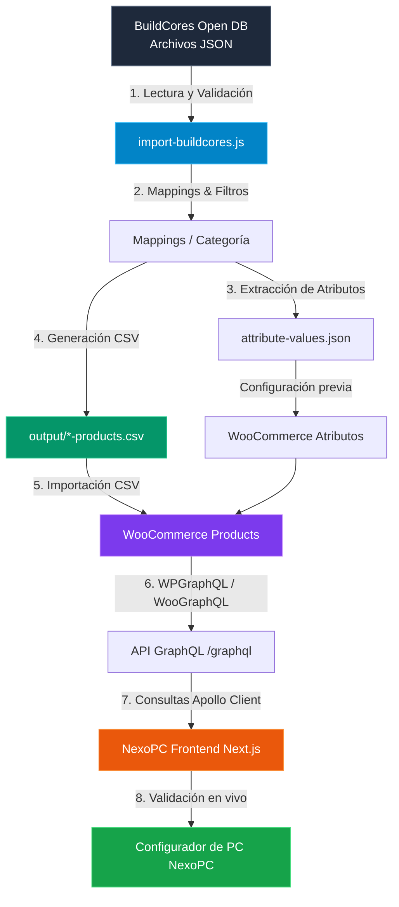

# 📚 Integración de BuildCores Open DB en NexoPC

Este documento detalla la arquitectura, el flujo de trabajo y las instrucciones operativas para sincronizar la base de datos abierta de componentes de hardware **[BuildCores Open DB](https://github.com/buildcores/buildcores-open-db)** con el backend de **NexoPC** (WordPress + WooCommerce + WPGraphQL + WooGraphQL).

---

## 📑 Tabla de Contenidos

1. [Descripción General y Objetivos](#1-descripción-general-y-objetivos)
2. [Arquitectura de Datos y Flujo de Integración](#2-arquitectura-de-datos-y-flujo-de-integración)
3. [Estructura del Proyecto](#3-estructura-del-proyecto)
4. [Requisitos Previos](#4-requisitos-previos)
5. [Instrucciones Paso a Paso](#5-instrucciones-paso-a-paso)
   - [Paso 1: Clonar BuildCores Open DB](#paso-1-clonar-buildcores-open-db)
   - [Paso 2: Instalación de Dependencias](#paso-2-instalación-de-dependencias)
   - [Paso 3: Ejecución del Script de Importación](#paso-3-ejecución-del-script-de-importación)
6. [Diccionario de Atributos y Reglas de Compatibilidad](#6-diccionario-de-atributos-y-reglas-de-compatibilidad)
7. [Guía de Importación a WooCommerce](#7-guía-de-importación-a-woocommerce)
   - [Creación de Atributos Globales](#creación-de-atributos-globales)
   - [Opción A: Importador Nativo de WooCommerce](#opción-a-importador-nativo-de-woocommerce)
   - [Opción B: WP All Import (Recomendado)](#opción-b-wp-all-import-recomendado)
8. [Extensibilidad: Añadir Nuevas Categorías](#8-extensibilidad-añadir-nuevas-categorías)
9. [Solución de Problemas (Troubleshooting)](#9-solución-de-problemas-troubleshooting)

---

## 1. Descripción General y Objetivos

NexoPC incorpora un **Configurador de PC inteligente** que evalúa la compatibilidad física y eléctrica entre componentes en tiempo real. Para que este motor funcione con fidelidad comercial, el catálogo de productos requiere especificaciones técnicas precisas y estandarizadas (sockets, tipos de memoria, consumos TDP, potencias y dimensiones).

### Objetivos clave:
1. **Población automatizada del catálogo:** Generar productos reales con nombres profesionales (`${fabricante} ${modelo}`).
2. **Estandarización de atributos:** Transformar datos heterogéneos de BuildCores a taxonomías y atributos de WooCommerce.
3. **Trazabilidad y SKUs:** Usar el `opendb_id` como SKU y metadato (`_opendb_id`) para futuras actualizaciones delta.
4. **Formato universal:** CSVs compatibles con el importador nativo de WooCommerce y con WP All Import.

---

## 2. Arquitectura de Datos y Flujo de Integración



---

## 3. Estructura del Proyecto

Dentro del repositorio `nexopc-backend`:

```
nexopc-backend/
├── scripts/
│   └── buildcores/
│       ├── data/                    # Archivos JSON de BuildCores (git-ignored)
│       │   ├── CPU/
│       │   ├── GPU/
│       │   ├── Motherboard/
│       │   ├── RAM/
│       │   ├── Storage/
│       │   ├── PSU/
│       │   └── Case/
│       ├── mappings/                # Lógica por categoría
│       │   ├── cpu-mapping.js
│       │   ├── gpu-mapping.js
│       │   ├── motherboard-mapping.js
│       │   ├── ram-mapping.js
│       │   ├── storage-mapping.js
│       │   ├── psu-mapping.js
│       │   └── case-mapping.js
│       ├── output/                  # Archivos generados
│       │   ├── attribute-values.json
│       │   ├── cpu-products.csv
│       │   ├── gpu-products.csv
│       │   ├── ...
│       │   ├── all-products.csv
│       │   └── import-YYYY-MM-DD.log
│       ├── import-buildcores.js     # Script principal CLI
│       ├── utils.js                 # Constantes y formateo
│       ├── package.json
│       └── README.md
├── docs/
│   └── buildcores-integration.md    # Esta documentación
└── .gitignore                       # Exclusión de datos pesados
```

---

## 4. Requisitos Previos

- **Node.js:** Versión 18+ (recomendado 20+).
- **Git:** Instalado en el sistema operativo.
- **Permisos de escritura** en `scripts/buildcores/output/`.

---

## 5. Instrucciones Paso a Paso

### Paso 1: Clonar BuildCores Open DB
Descarga la base de datos oficial en la carpeta `scripts/buildcores/data`:

```bash
# Desde la raíz del repositorio
cd scripts/buildcores

# Clonar los datos en el directorio data/
git clone https://github.com/buildcores/buildcores-open-db.git data
```

> **Nota:** La carpeta `data/` se encuentra excluida en el `.gitignore` para no sobrecargar el repositorio de código.

### Paso 2: Instalación de Dependencias
Instala los paquetes necesarios (`commander` y `csv-writer`):

```bash
cd scripts/buildcores
npm install
```

### Paso 3: Ejecución del Script de Importación

#### A. Importación estándar (todas las categorías)
```bash
node import-buildcores.js
```

#### B. Generar un archivo CSV unificado para todas las categorías
```bash
node import-buildcores.js --unified
```

#### C. Limitar a un número de productos por categoría (ideal para pruebas rápidas)
```bash
node import-buildcores.js --categories=CPU,GPU --limit=50
```

#### D. Filtrar solo componentes de gama media-alta / gaming
```bash
node import-buildcores.js --tier=mid-high
```

#### E. Establecer un precio base inicial
```bash
node import-buildcores.js --base-price=0
```

---

## 6. Diccionario de Atributos y Reglas de Compatibilidad

El configurador de NexoPC evalúa las siguientes reglas de compatibilidad entre los atributos generados:

| Atributo WooCommerce | Slug | Categorías que lo usan | Propósito en el Configurador NexoPC |
|---|---|---|---|
| **Socket** | `pa_socket` | CPU, Placas Madre | Verifica que el procesador encaje físicamente en el socket de la placa (ej. AM5 con AM5). |
| **Tipo de RAM** | `pa_tipo-ram` | Placas Madre, Memoria RAM | Valida la generación de memoria (DDR4 vs DDR5). |
| **Consumo TDP** | `pa_tdp` | CPU, Tarjetas Gráficas | Estima la disipación térmica y cálculo de potencia de la fuente. |
| **Formato** | `pa_formato` | Placas Madre, Fuentes, Gabinetes | Valida que el tamaño de la placa (ATX, Micro-ATX, Mini-ITX) quepa en el gabinete. |
| **Longitud GPU** | `pa_longitud-gpu` | Tarjetas Gráficas, Gabinetes | Comprueba que la longitud de la GPU (en mm) no exceda el espacio interior del gabinete. |
| **Vatios** | `pa_vatios` | Fuentes de Poder | Valida que la fuente de poder entregue suficiente wattage según CPU + GPU. |
| **Tipo de Almacenamiento** | `pa_tipo-almacenamiento` | Almacenamiento | Identifica si es NVMe M.2 o SATA de 2.5". |
| **Capacidad** | `pa_capacidad-gb` | RAM, GPU, Almacenamiento | Muestra la capacidad en GB al usuario en filtros y fichas técnicas. |
| **Marca** | `pa_marca` | Todas las categorías | Facilita filtros por marca en el frontend (AMD, Intel, ASUS, etc.). |

Al finalizar la ejecución, el archivo `scripts/buildcores/output/attribute-values.json` contendrá la lista completa de todos los términos encontrados.

---

## 7. Guía de Importación a WooCommerce

### Creación de Atributos Globales
Antes de importar los productos, es una buena práctica registrar los atributos en WordPress para que WooCommerce los vincule globalmente:

1. Ingresa al panel de administración: `https://wordpress.wrkz.net/wp-admin` (o tu entorno local).
2. Ve a **Productos → Atributos**.
3. Abre `scripts/buildcores/output/attribute-values.json`.
4. Añade los atributos con sus nombres y slugs:
   - **Nombre:** `Socket` | **Slug:** `socket`
   - **Nombre:** `Tipo de RAM` | **Slug:** `tipo-ram`
   - **Nombre:** `TDP` | **Slug:** `tdp`
   - **Nombre:** `Formato` | **Slug:** `formato`
   - **Nombre:** `Longitud GPU` | **Slug:** `longitud-gpu`
   - **Nombre:** `Vatios` | **Slug:** `vatios`
   - **Nombre:** `Tipo de Almacenamiento` | **Slug:** `tipo-almacenamiento`
   - **Nombre:** `Capacidad (GB)` | **Slug:** `capacidad-gb`
   - **Nombre:** `Marca` | **Slug:** `marca`
5. *(Opcional)* Haz clic en **Configurar términos** para cada atributo y añade los valores listados en `attribute-values.json`.

---

### Opción A: Importador Nativo de WooCommerce
1. Dirígete a **Productos → Todos los productos**.
2. Haz clic en el botón superior **Importar**.
3. Selecciona el archivo CSV (ejemplo: `output/cpu-products.csv`).
4. Marca la opción **"¿Actualizar los productos existentes?"** si estás resincronizando datos con el mismo SKU.
5. En la pantalla de mapeo de columnas, WooCommerce detectará la mayoría de campos automáticamente:
   - `Name` → Nombre del producto
   - `SKU` → SKU
   - `Description` → Descripción
   - `Categories` → Categorías
   - `Tags` → Etiquetas
   - `Attribute: socket` → Atributo: Socket
   - `Attribute: tipo-ram` → Atributo: Tipo de RAM
   - `Meta: opendb_id` → Campo personalizado `opendb_id`
   - `Meta: _opendb_id` → Campo personalizado `_opendb_id`
6. Haz clic en **Ejecutar el importador** y espera a que finalice.

---

### Opción B: WP All Import (Recomendado para Grandes Volúmenes)
1. Instala y activa **WP All Import Pro** junto con el add-on **WooCommerce Add-On**.
2. Ve a **All Import → New Import**.
3. Sube el archivo CSV (`all-products.csv` o por categoría).
4. Selecciona **WooCommerce Products**.
5. En el paso de mapeo:
   - Arrastra `Name` al título y `Description` al contenido.
   - En la pestaña **WooCommerce Add-On → General**, asigna `Regular price`.
   - En la pestaña **Attributes**, añade cada atributo dinámicamente mapeándolo a `Attribute: {slug}`.
   - En la pestaña **Custom Fields**, mapea `opendb_id` y `manufacturer`.
6. En el paso de **Record Identifier**, haz clic en **Auto-detect** o selecciona `{sku[1]}`.
7. Guarda y ejecuta el proceso de importación.

---

## 8. Extensibilidad: Añadir Nuevas Categorías

Para añadir soporte a nuevas categorías de hardware (por ejemplo, `Cooler` para refrigeración de CPU):

1. **Crear archivo de mapeo:**
   Crea `scripts/buildcores/mappings/cooler-mapping.js` implementando la interfaz estándar:
   ```javascript
   module.exports = {
     category: 'Cooler',
     woocommerceCategory: 'Refrigeración',
     folderNames: ['Cooler', 'CPUCooler', 'cooler'],
     validate(data) { ... },
     filter(data, options) { ... },
     map(data, options) { ... }
   };
   ```

2. **Registrar en `import-buildcores.js`:**
   Añade el módulo al objeto `mappings`:
   ```javascript
   const mappings = {
     // ...
     Cooler: require('./mappings/cooler-mapping')
   };
   ```

3. **Ejecutar la categoría:**
   ```bash
   node import-buildcores.js --categories=Cooler
   ```

---

## 9. Solución de Problemas (Troubleshooting)

### Error: "Carpeta no encontrada para CPU en scripts/buildcores/data"
- **Causa:** No se ha clonado el repositorio de BuildCores o se clonó en una subcarpeta distinta.
- **Solución:** Verifica que dentro de `data/` existan las carpetas de componentes (ej: `data/CPU` o `data/open-db/CPU`). El script busca automáticamente en ambas estructuras.

### Error: "Campos faltantes / Producto omitido"
- **Causa:** Ciertos componentes en la base de datos abierta carecen de valores obligatorios para compatibilidad (por ejemplo, un procesador sin el campo `socket`).
- **Solución:** El script omite deliberadamente estos elementos para proteger la integridad del configurador. Consulta el archivo de registro `output/import-YYYY-MM-DD.log` para conocer el ID del archivo y la causa exacta.

### Los atributos no se muestran en WPGraphQL
- **Causa:** WooCommerce no ha registrado los atributos como públicos o el esquema GraphQL necesita refrescarse.
- **Solución:**
  1. En **Productos → Atributos**, edita el atributo y asegúrate de que **"¿Activar archivos?"** esté marcado.
  2. En el panel de WordPress, desactiva y vuelve a activar **WPGraphQL** para invalidar la caché del esquema.
